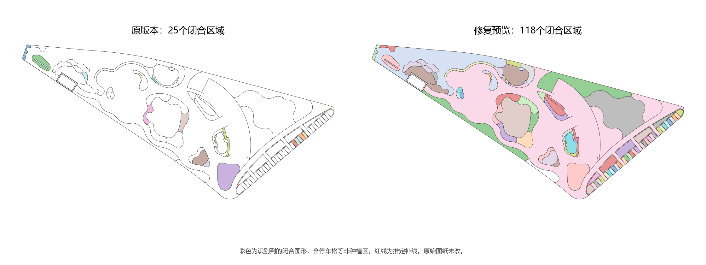

# 本轮修改（0.3.22）

- 灌木面积引线改为先点折点，再点水平横线尾端及左右方向，最后选择或输入植物品种。
- 品种窗口可检索项目规格、选择具体尺寸、从品种库添加或手输名称；同名多规格需明确选定。取消时保留原关联和标注。
- 修复刷新重新套用当前CAD字体的路径；图纸采用专用文字和引线样式，左右两侧明确附着规则，每条标注保留各自的单行/双行配置。
- 换品种、移动夹点或刷新后保留实际折点和横线端点。旧标注执行PLANTCADSYNC一次应用稳定性修复。
- 260项自动检查、190项关联输出、两点生产流程及20项既有标注反馈检查通过。真实鼠标/DCL和打印验收另行记录，不宣称完成。

详见[两点引线与样式稳定性](两点引线与样式稳定性.md)。

# 本轮修改（0.3.21）

- 统一边线计算顺序，直线/圆弧用解析交点处理近切误差；对CAD拒绝的闭环仅在接缝附近局部拟合，保留主要圆弧，以面积误差上限、2048段输入及7次尝试限制处理。
- 按每个区域的世界坐标和圆弧半径估计精度，不再让远处长尾线直接压制正常小区域。几何检查增至150项。
- 修复复合面域分解后仍为Region导致填充失败，递归取完整曲线，区分多个外环与内孔。原生关联输出增至94项。
- 修复极短拟合接缝的最近点比较失败，以及旧面域包围盒微差导致升级后出现平行面积记录。案例18项检查通过，重复扫描保持区域和文字数量。
- “查看植物或范围属性”补齐区域与面积标注入口，可查看拟合来源；拟合标记随区域保存并在复用时保留。
- 原117个核对区域的轮廓和面积全部保留；118个当前几何图形在原序、反序、编号序及打乱顺序中一致，含额外极小边角和非种植区。
- 桌面实测仍受启动输入提示阻塞，未声明最终DLL完整GUI通过。报告和包保留真实状态；原图不改。

详见[整体复查报告](整体复查报告.md)。

# 此前修改（0.3.20）

- 修复“节点已闭合但CAD无法建立面域”的漏算：在数值容差内统一临时轮廓接缝，保留圆弧凸度并校验面积误差。原边线形状不改，不通过扩大缺口容差强行合并花池。
- 案例2同一241条灌木层边线，从25个闭合区域增加到117个；含停车格等非种植区，不能当作117块灌木统计。8个原漏算位置、全部区内面积文字及重复扫描复用检查通过。
- 修复大坐标下细小区域判重时混用世界坐标面积和局部面积，连续扫描保持117个区域和117条内部文字。
- 新增22项微小接缝、反向曲线和大坐标圆弧几何检查；几何检查合计146项，案例生产出图16项通过。最终0.3.20已安装，9个运行文件散列匹配；246项自动检查和最终DLL内核回归通过。
- 候选版曾通过案例桌面复测；最终DLL的桌面回归尚未完成。测试CAD停在启动回车提示，自动操作无法激活输入窗口；只关闭了自建测试进程，未改用户原图。此前桌面报告保留原运行文件散列，不作为最终DLL的通过证据。

大坐标输出时，另将2个低于坐标精度误差界的微小碎片提示核对，避免当作有效种植区；117个几何闭合图形仍包含停车格等非种植区。既有面域比对失败改用双向边界校核，单个旧记录不会阻断新区域输出。

## 此前修改（0.3.19）

- 项目植物与规格改为可拖拽缩放及最大化的原生窗口，列表随窗口扩展，参数列可调宽；保留全部分类、检索、修改规格、复制及布置操作，筛选/排序后保持正确规格对应。
- 修复案例2灌木边界在交点转参数和切分时的eInvalidInput：临时副本改用局部坐标计算，生成区域与标注还原原位置，不平移原始边线。

- 0.3.19已安装，9个运行文件散列匹配。246项自动检查、13项窗口控件、案例副本11项流程加8项实际窗口检查及59项完整桌面回归通过；案例2的241条灌木边线识别25个区域并全部生成内部面积文字。原图未改，测试进程已关闭。

## 此前修改（0.3.18）

- 表格图例带植物名称，图形和文字整体等比缩小。球名居中，乔木保留真实径值；面积填充图例上方显示名称。已有表按原句柄和位置升级，编号第一列保留。
- 项目规格列表所有类别统一八列：分类、编号、名称、高度、冠幅、胸径、地径、单位；表头与参数固定制表位对齐。
- 灌木面积标注随出图比例和字高更新，文字位置与引线起点保持。灌木球名称居中，球下方径值及编号隐藏；乔木下方编号隐藏。
- 直接改关联标注名称后，统计或显式更新会先识别更名，再刷新关联表；手工面积数字不覆盖几何。同名多规格需明确编号。
- 主菜单生成全模型“苗木数量总表”，按乔木、灌木球、灌木地被排序；所选范围和分表独立保留。所有面积显示固定两位小数，计算精度保留。
- 242项自动检查、87项原生关联输出、31项分表、20项改名与总表反馈、58项真实桌面检查通过；实际图文边界检查覆盖所有总表行。0.3.18已安装，9个安装文件散列匹配，原图未改。

## 此前修改（0.3.16）

- 已保存图纸中复现表头字高1000、数据行仅2.5。修复Contents.Clear后字体固定高度覆盖数据行的问题，在写入完成后统一应用内容字高，并使用保留原字体、无固定高度的专用表格文字样式。
- 编号第一列、图例第二列，旧关联表显式同步时保留句柄和位置升级；表格规格回写仍兼容原列顺序。
- 单株所选胸径/地径未填写时，名称下方不显示横杠，有真实径值的标注保留。
- 统计新增乔木/灌木球/灌木地被三类表、按品种分表、拆分已有数量/名录/规格表。沿用统计范围，自动排列并跳过空类别，原总表保留。分表筛选随DWG保存，规格修改保持关联。
- 修复手输灌木名称后建立平方米规格、后续表格回读却只接受株/丛的校验矛盾。面积类规格允许平方米，项目规格编辑保留此单位，单株布置提示改用株/丛；避免同步错误弹窗阻塞操作。
- 199项规则、73项原生关联输出、31项分表保存重开及47项真实桌面检查通过。最终0.3.16已安装，9个运行文件散列匹配。原图未改，已有图纸执行PLANTCADSYNC更新表格和单株占位符。

## 此前修改（0.3.15）

- 修复重复扫描直接跳过已有面域、没有检查内部文字的问题。已有区域复查并补回缺失内部面积指标，保留编号、植物、单位及推定记录，避免重复区域和重复内部文字。
- 增加“布置 → 手动补面积”（PLANTCADAREAADD）：点闭合边界、跨图层框选组成边线。手动入口在副本上计算，原始边线颜色、标高、图层保持；未真正闭合或无法唯一确定时提示辅助整理。
- 自动扫描继续按确认的灌木边界图层计算；其他图层被排除时在命令行说明，可改用手动框选组合边线。
- 新增28项手动测量内核和LISP检查；190项规则及42项真实桌面检查通过。最新图纸副本中已有6块区域缺失的标注全部补齐，编号和区域数量保持，原图未改。最终0.3.15已安装，9个安装文件散列与构建一致。

## 此前修改（0.3.14）

- 出图引线改用原生整体MULTILEADER，移动、夹点调整与撤销时文字和引线同行；规格更新保留已移动位置。旧标注运行PLANTCADSYNC转换。
- 修复旧统计表逐格重绘：只写变化单元格，批量写入暂缓重建，成功或异常均恢复设置。
- 放标注时新增Name输入名称/规格编号；新名称只建立面积规格，复用唯一现有规格，歧义不猜。
- 灌木填充默认随图层灰色ACI8，迁移旧版默认黄/绿层色。
- 本轮桌面副本测得标注收尾1297毫秒，后续显式同步750毫秒；35项桌面、66项原生关联输出及188项规则检查通过，原图未改。

## 此前修改（0.3.13）

- 用户反馈删除植物或填充后CAD未响应。代码存在普通CAD命令后自动全图更新、重建被删填充的路径，作为可疑触发源停用。没有取得用户卡死现场调用栈，不能仅凭代码判定唯一根因。
- 数据库通知不再读取植物扩展数据，也不从命令结束事件排队图纸写入。项目规格修改仍自动关联；直接编辑CAD表格、移动或删除后按需使用“更新关联标注”。
- 显式同步保留正常撤销标记与统一错误处理。新增独立桌面CAD副本删除/撤销回归，覆盖真实事件、属性和LDATA；实测结果见验证报告。

## 此前修改（0.3.12）

- 补齐植物库“形态”中的灌木球、花境和草坪入口，按用途选择后自动建立对应类别的规格；修复项目筛选只循环旧三类、隐藏新增类别的问题。
- 在实际已保存图纸副本上复现19个区域中13个填充失败，定位为AutoCAD2014的Curve.ReverseCurve不支持部分面域边缘曲线。改为按端点记录遍历方向，保留原曲线供CAD构建填充闭环。
- 面积出图先生成引线和文字，填充随后单独尝试，不因填充错误丢失整个标注操作。
- 取消只读窗口及切换当前植物后的全图同步；未变化的图块内部文字不再重复执行COM写入。同步内复用实体列表、引线索引、面积和统计结果，跨操作缓存未变化的边界签名；真实几何改动自动失效。
- 每次面板刷新只读取一次状态。原始DWG只读，复现与验证均在副本上完成。

## 此前修改（0.3.11）

- 灌木球按单株插入，与乔木复用尺寸、图例属性和双击编辑，使用独立图形、标注图层。新增花境、草坪类别。
- “开始布置”点击后展开方式菜单；规格窗口增加全部植物下拉选择。
- 已算面积可按关联植物自动填充，图案允许重复；支持曲线及内孔，不叠加旧填充。
- 已算面积可生成植物/面积两行或同排的出图引线，按纸面字高和比例生成，保留补线推定提示。
- 统计可直接在CAD插入带编号和图例的关联表。修改项目规格或表中名称、编号、尺寸会同步图中同规格对象和受管理表；数量及面积仍从图纸计算。
- 实体与关联数据随DWG保存。新增原生内核及保存重开验证；天正桌面实际点选、双击和打印仍需现场验收。

## 此前修改（0.3.10）

- 面积识别确认边线图层后，将框选中的该层有效原始曲线标高归零、颜色统一为随图层。支持LINE、PLINE、旧二维/三维多段线、SPLINE、水平圆弧/圆/椭圆，保留平面轮廓、句柄、图层和扩展资料。未选线及其他图层不变；不自动解锁图层。
- 归零步骤与几何计算同属事务，失败回滚；缺口推定仍在副本进行。需要改变实体类型的倾斜边界提示先处理，不强行改成别的曲线。
- “已算面积关联当前植物”现在可选面积文字或计算边界，支持预选、多选与同一区域去重。
- 新增“从已有品种标注关联面积”：PlantCAD标注直接取得原规格；普通文字、多行文字、引线和图块文字匹配项目植物。名称不唯一时要求指定规格，不猜测。
- 对已安装天正等扩展的自定义标注，尝试读取它提供的临时分解文字；不实际拆散原标注，读不到时保留手动项目关联入口。
- 关联后自动刷新“灌木名称＋面积”标注和统计，原品种文字保留，面积/几何/推定状态不变。

169项自动检查；189项真实CAD边线归零与颜色检查，包括不同标高、平面轮廓、扩展资料、未选线、锁定层与失败回滚；33项预选/面积/标注关联检查，在28个混合图层对象中生成13个区域，再匹配不同形式的品种标注并汇总；124项几何检查、38项保存重开检查、12项原生LISP规则、13项放树互操作与46个实际菜单事件通过。

宿主检查使用专用DWG副本，元数据/图层仍使用Core Console适配层。天正真实鼠标操作、专有标注实体、桌面撤销和用户图纸数值不在上述验收范围。未替用户修改当前图纸。
