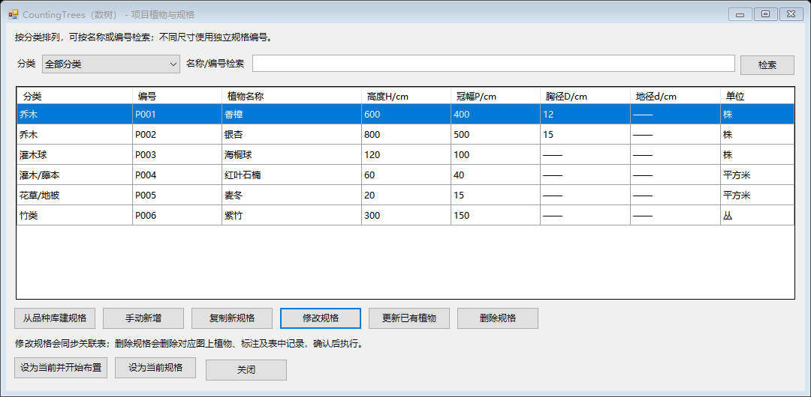
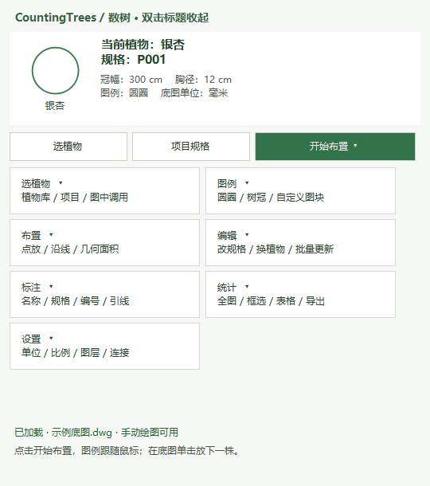
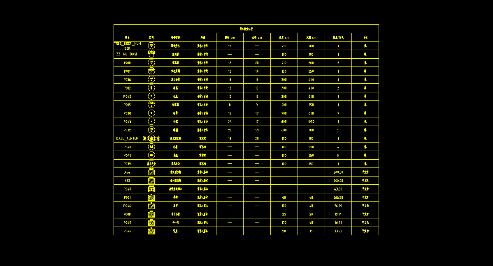
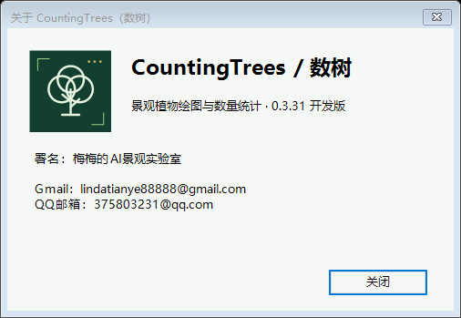

<p align="center">
  
</p>

<p align="center">
  <b>把选植物、定规格、布置、面积标注和苗木数量表，接在同一条 CAD 工作流里。</b><br>
  Windows · AutoCAD · 对应版本天正 · 当前开发版 0.3.31
</p>

<p align="center">
  <a href="releases/CountingTrees_数树_0.3.31.zip">下载安装包</a> ·
  <a href="开始使用.md">快速开始</a> ·
  <a href="PlantCAD-0.3/README.md">完整操作手册</a> ·
  <a href="https://github.com/lindatianye88888-commits/CountingTrees/issues">反馈问题</a>
</p>

## 数树解决什么问题

CountingTrees（数树）是面向景观植物设计和施工图深化的 Windows CAD 插件。它把植物名称、规格、图上对象和数量表建立关联，让设计师在一套项目规格中完成绘图、调整和统计，减少反复填写名称、核对面积与手工改表的工作。

适合已有景观平面底图、需要继续配置植物与整理苗木表的设计师。你负责植物选择、规格和种植范围的设计判断，数树负责图形布置、几何面积、关联标注及数量汇总。

| 你的任务 | 数树提供的操作 | 得到的结果 |
| --- | --- | --- |
| 同一品种有多个尺寸，需要分别管理 | 从品种库建规格，或手动新增、复制规格 | 独立编号的项目植物清单 |
| 在平面上配置乔木、灌木球或竹类 | 选图例、补冠幅，点放或沿线布置 | 带名称与规格信息的植物对象 |
| 灌木地被需要量面积、填充并引出标注 | 识别边界、关联品种、区域填充、两点引线 | 面积、品种及引线关联的区域标注 |
| 改完设计后需要同步苗木表 | 更新项目规格、更新已有植物、刷新关联表 | 总表，以及按类别或品种拆分的表 |

## 一次完整的绘图流程


### 1. 先把项目植物和规格定清楚

品种库包含 **482 项植物记录**，竹类共 **17 项**。支持乔木、灌木球、灌木／藤本、花草／地被、花境、草坪和竹类。同名不同尺寸可建为不同编号；参数按列对齐，窗口可缩放、筛选和检索。

“更新已有植物”允许从图中混选植物图块、文字和灌木标注，补入项目清单。普通文字只收录名称，**不会把文字里的数字直接当成株数或面积**；没有数量来源时显示“待关联”。



*实际程序窗口，使用示例植物与规格演示，参数不构成种植建议。*

### 2. 在 CAD 中完成布置、填充和标注

工作台把选植物、图例、布置、编辑、标注、统计与设置集中在一个浮窗。双击标题可收起为小圆标，继续在底图上绘图。

- **单株植物**：选择圆圈、简化树冠或自定义普通图块，确认冠幅后布置。
- **灌木区域**：识别可用边界并计算面积，也可手动辅助补面积；关联品种后填充和标注。
- **引出标注**：第一点定折点，第二点定横线尾端与左右方向，随后选择或输入品种。
- **字高控制**：单位、出图比例与纸面字高统一控制关联标注；新图默认纸面字高 **1 cm**，旧图保留已保存的设置。

<p align="center"></p>

*工作台实际控件的示例状态。区域识别结果仍需设计师检查，尤其是补线推定的区域。*

### 3. 生成总表，让后续调整有据可查

总表包含编号、带名称的图例、植物名称、类别、苗木规格、数量／面积和单位。可按乔木及竹类、灌木球、灌木地被分组，也可按品种拆表；面积统一显示两位小数。修改项目规格会同步关联对象与数树生成的表。

“删除规格”在确认后删除对应图上植物、采集文字、计算区域、标注和填充，并移除表内记录；仅含该规格的表会一并删除。同名不同规格分别处理，原始底图边线及品种库保留。



*AutoCAD 开发环境中的原生表格实测截图，含测试编号和示例数据；用于展示表格结构，不是完整施工图交付样板。*

## 安装与第一次使用

1. 下载 [0.3.31 安装包](releases/CountingTrees_数树_0.3.31.zip)，解压到固定目录。可用 [SHA-256 校验文件](releases/CountingTrees_数树_0.3.31.zip.sha256)核对下载。
2. 保存图纸并关闭 AutoCAD／天正，双击 `PlantCAD-0.3/安装操作面板.cmd`。安装脚本需要 Python 3，开发环境使用 Python 3.12。
3. 重新打开 CAD，输入 `COUNTINGTREES` 或 `数树`，打开植物工作台。
4. 在“设置”中确认底图单位、出图比例与字高，再从“项目规格”建立第一个植物规格。
5. 布置一株植物或关联一块已测区域，生成一张总表，检查文字、图例及数量是否符合你的出图要求。

安装器只配置当前用户的 CAD 插件目录；保留 `PlantCAD` 技术目录、历史命令和图纸字典名称，以兼容已有图纸与连接配置。

## 兼容性：哪些已验证，哪些仍在适配

| 环境 | 当前状态 |
| --- | --- |
| Windows 64 位 + 完整 AutoCAD 2014 | 本机开发与原生 CAD 内核验证环境 |
| AutoCAD 2014 + 天正 TArch9 | 已有开发实测记录；最新版本完整桌面交互与打印仍待验收 |
| AutoCAD 2015—2024 + 对应天正 | 六组适配 DLL 已编译；尚未完成各版本配套实机验收 |
| AutoCAD LT、Mac、其他 CAD 内核 | 未列入本版验证范围 |

当前为**开发版**。0.3.30 核心功能已通过 323 项自动检查、19 项项目窗口检查、53 项 AutoCAD 2014 删除／撤销／保存重开检查和209项标注回归；0.3.31 增加了品牌与关于窗口检查。编译通过不等同于所有宿主版本可稳定交付。

[查看兼容性与测试矩阵](PlantCAD-0.3/docs/兼容性与测试矩阵.md)

## 使用边界与已知问题

- **补线推定需核对**：自动补线可能把相邻边线间的细缝识别为额外小区域，显示为“0.00 平方米”。这项筛选仍待修复，不代表旁边主种植区域面积为零。
- **底图改动后要重算**：计算区域是扫描时的几何快照。修改原始边界后，需要重新扫描；闭合识别不承诺覆盖任意破损线网。
- **填充与计量分开核对**：大坐标曲线被原生填充内核拒绝时，仅对填充辅助轮廓作有误差上限的近似，统计仍使用原计算几何。
- **关联输出有范围**：同步针对数树管理的对象及关联表，不会自动接管任意第三方图块、天正专有对象或普通表格。

建议先在图纸副本上验证单位、面积、标注及总表，再用于项目生产。

## 最新版本与历史包

| 版本 | 变化 | 下载 |
| --- | --- | --- |
| **0.3.31** | 新 logo、带署名与联系方式的关于窗口、产品首页与配图；包含下列核心修复 | [最新开发包](releases/CountingTrees_数树_0.3.31.zip) |
| 0.3.30 | 独立竹类、默认纸面字高1cm、删除规格与同步删图删表 | [安装包](releases/CountingTrees_数树_0.3.30.zip) · [说明](PlantCAD-0.3/docs/竹类与项目规格删除.md) |
| 0.3.29 | 大坐标区域填充回退与保存重开修复 | [修复说明](PlantCAD-0.3/docs/大坐标区域填充修复.md) |
| 0.3.23 | 保留的 AutoCAD 2014／TArch9 历史快照 | [历史包](releases/CountingTrees_数树_0.3.23_CAD2014_TArch9.zip) · [来源与保留说明](PlantCAD-0.3.23-CAD2014-TArch9/保留说明.md) |

## 开发与问题反馈

| 路径 | 内容 |
| --- | --- |
| `PlantCAD-0.3/developer/src` | UTF-8 AutoLISP、DCL 与植物库源码 |
| `PlantCAD-0.3/bridge/src` | C# 工作台、CAD 桥接、几何和出图逻辑 |
| `PlantCAD-0.3/developer/tests`、`bridge/tests` | 规则、流程、原生验证驱动及MCP协议测试 |
| `PlantCAD-0.3/docs` | 操作、开发、兼容与验证说明 |
| `PlantCAD-0.3/docs/images/countingtrees-logo.svg` | 可缩放 logo 源文件；同目录提供PNG |
| `releases` | 安装包与校验文件 |

无需打开 CAD 即可运行规则与协议检查：

```powershell
python -B -m unittest discover -s PlantCAD-0.3/developer/tests
python -B -m unittest discover -s PlantCAD-0.3/bridge/tests
```

完整构建需要 Windows、.NET Framework 编译器和各版本 Autodesk 托管 API 引用。参见[开发说明](PlantCAD-0.3/docs/开发说明.md)。运行文件由UTF-8源码生成GBK／CRLF版本，请修改源码后构建。可选的[本地 MCP 接口](PlantCAD-0.3/bridge/README.md)用于受控读取和操作已连接图纸，日常手动绘图无需连接 MCP。

反馈时请提供 CAD／天正版本、数树版本、具体命令、复现步骤和错误提示。可通过 [Issues](https://github.com/lindatianye88888-commits/CountingTrees/issues)提交；不便公开的图纸请先脱敏。仓库与安装包不含私有案例原图、公众号素材、本机连接配置、运行队列或第三方SDK DLL。

## 作者与联系

**梅梅的AI景观实验室**

Gmail：[lindatianye88888@gmail.com](mailto:lindatianye88888@gmail.com) · QQ邮箱：[375803231@qq.com](mailto:375803231@qq.com)

软件工作台底部“关于/联系”和小圆标右键菜单均提供署名入口。logo以树冠、计数点和图纸定位角表达“数树”，提供SVG与PNG两种格式。

<p align="center"></p>
